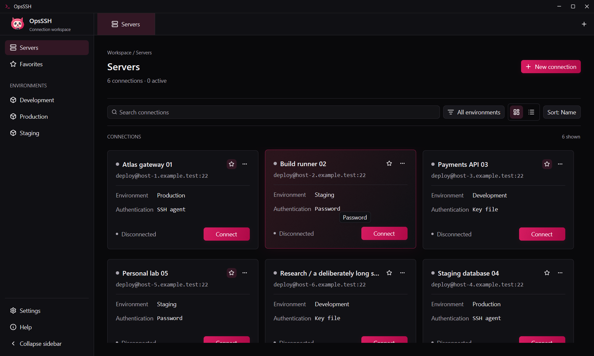
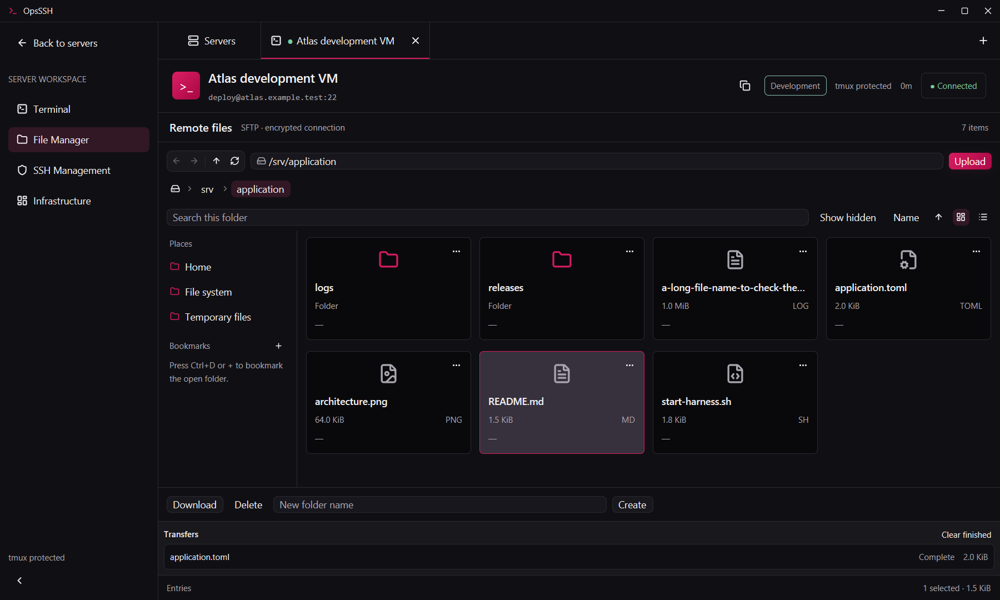

<p align="center">
  
</p>

<h1 align="center">OpsSSH</h1>

<p align="center">
  A fast, native SSH workspace for your servers: terminals, a real remote file manager,
  and SSH key management in one desktop app.
</p>

<p align="center">
  <a href="https://github.com/priyansx01/OpsSSH/releases/latest"></a>
  <a href="https://github.com/priyansx01/OpsSSH/actions/workflows/ci.yml"></a>
  <a href="LICENSE-MIT"></a>
</p>

<p align="center">
  <a href="#download">Download</a> ·
  <a href="#quick-start">Quick start</a> ·
  <a href="#features">Features</a> ·
  <a href="#keyboard-shortcuts">Shortcuts</a> ·
  <a href="#build-from-source">Build from source</a> ·
  <a href="#contributing">Contributing</a>
</p>



OpsSSH keeps your saved servers, local and remote terminals, an SFTP file manager
and SSH key management in one window. It is written in Rust with a GPU-rendered
UI (GPUI) and Alacritty's terminal emulator, so full-screen tools such as `vim`,
`htop` or Claude Code feel local. There is no account and no telemetry.

> **Status: 0.1.0, first public release.** Windows leads development; macOS and
> Linux builds are produced by CI. Builds are not code-signed yet, see
> [Download](#download).

## Download

Get the latest version from **[GitHub Releases](https://github.com/priyansx01/OpsSSH/releases/latest)**.

| Platform | File | How to install |
| --- | --- | --- |
| Windows 10/11 (x64) | `opsssh-<version>-windows-x64.msi` | Run the installer. It installs for your user only (no admin rights) and adds OpsSSH to the Start menu. |
| Windows, portable | `opsssh-<version>-x86_64-pc-windows-msvc.zip` | Extract and run `opsssh.exe`. |
| macOS (Apple silicon / Intel) | `opsssh-<version>-aarch64-apple-darwin.tar.gz` / `…-x86_64-apple-darwin.tar.gz` | Extract and run `opsssh`. |
| Linux (x64 / arm64) | `opsssh-<version>-x86_64-unknown-linux-gnu.tar.gz` / `…-aarch64-unknown-linux-gnu.tar.gz` | Extract and run `opsssh`. Needs a desktop session (Wayland or X11). |

Every file has a matching `.sha256`. Verify a download before running it:

```powershell
# Windows (PowerShell)
(Get-FileHash .\opsssh-0.1.0-windows-x64.msi -Algorithm SHA256).Hash
```

```sh
# macOS / Linux
shasum -a 256 -c opsssh-0.1.0-x86_64-unknown-linux-gnu.tar.gz.sha256
```

**Unsigned builds:** Windows SmartScreen may show "Windows protected your PC".
Choose **More info → Run anyway** after checking the checksum. On macOS, open the
app once with right-click → **Open**. Signed installers are planned for 1.0.

## Quick start

1. **Add a server.** Click **New connection**. Paste a command like
   `ssh deploy@203.0.113.10 -p 2222` into Quick Connect, or fill in host, port,
   user and how you sign in (password, key file, SSH agent, OTP/keyboard-interactive
   or certificate).
2. **Turn on "Protect work with tmux"** (optional, recommended). If the server has
   tmux, your session survives Wi-Fi drops, VPN changes and your PC sleeping.
   OpsSSH reconnects and reattaches automatically.
3. **Save & Connect.** The first time, check the host key fingerprint before
   trusting it. A changed key always stops the connection.
4. **Work.** Use the tab's sidebar to switch between **Terminal**, **File Manager**,
   **SSH Management** and **Infrastructure** (CPU, memory, disk and processes).

Passwords and passphrases go to your operating system's credential store only
if you tick **Save**. One-time codes are never stored.

## Features

### Terminal
- Local and SSH terminals with true colour, mouse support, 100,000 lines of
  history and multilingual text shaping.
- **Split panes:** **Split right** / **Split down** as often as you like, with
  draggable dividers. Remote panes open extra shells on the same connection, so
  there is no second login.
- Paste text with **Ctrl+V**, or paste a screenshot to upload it and insert its
  remote path. Drag files from your desktop into the terminal to upload them.
- Keys go to the terminal first, so editors and tools such as Claude Code get
  every shortcut. On Windows, **Keyboard capture** can even forward Alt+Tab.
- Optional **tmux protection**: automatic reconnect with back-off, **Reconnect now**,
  and quick recovery after your computer wakes from sleep.

### File manager



- Works like a Linux desktop file manager: grid and list views, **Places**
  (Home, `/`, `/tmp`, the terminal's folder) and per-server **bookmarks**.
- Select with **Ctrl/Shift+click**, **Ctrl+A** or by dragging a rectangle.
- **Drag & drop** onto folders, breadcrumbs, Up or Places to move (hold **Ctrl**
  to copy). Folders open when you hover over them while dragging.
- Drop files **from your desktop** onto any folder to upload them there.
- **Cut, copy and paste**, rename in place with **F2**, Back/Forward history
  (including mouse side buttons), hidden files with **Ctrl+H**.
- One clear **conflict dialog** for every upload, download, copy and move:
  **Replace**, **Keep both** (`report (2).txt`), **Skip** or **Cancel**, with
  *Apply to all*. Same-named folders merge item by item.
- Safe transfers: moves are atomic renames, replaced files are written beside
  the original first, and a failed download never truncates your local file.
- Permissions editor with presets, an advanced matrix, octal modes, owner/group
  and recursive changes.

### SSH management and servers
- Saved connections with environments, tags, favourites, search, import/export
  and concrete aliases from your SSH config.
- Jump hosts, reviewed proxy commands and configurable keepalive.
- Manage `~/.ssh/authorized_keys` (add, search, comment, export, remove) without
  locking out the key you are using, and create Linux users with sudo.
  See [SSH Management](docs/SSH_MANAGEMENT.md).

### Windows integration
- Right-click a folder, the empty space inside one, or a drive in File Explorer
  and choose **OpsSSH ▸ Open terminal here** for a local terminal in that folder,
  or **Open OpsSSH** for the app. On Windows 11 the entry is under
  **Show more options** (or Shift+right-click).
- An open OpsSSH window is reused: it comes to the front with a new tab instead
  of starting a second copy.
- From any shell: `opsssh local <folder>`.

### Experimental
- **Drag files out to your desktop.** Start OpsSSH with
  `OPSSSH_EXPERIMENTAL_DRAG_OUT=1`. On Windows, dropping onto a File Explorer
  window or the desktop downloads into that folder straight away. Feedback is
  welcome while it is being validated.

## Keyboard shortcuts

**Workspace** (when no terminal has focus):

| Action | Shortcut |
| --- | --- |
| Open local shell | Ctrl/Cmd+Enter |
| Search servers | Ctrl/Cmd+K |
| New connection | Ctrl/Cmd+N |
| Close tab | Ctrl/Cmd+W |
| Home, keep sessions running | Ctrl/Cmd+Shift+H |
| Quit | Ctrl+Shift+Q (Cmd+Q on macOS) |

**Terminal:** drag to select (**Alt+drag** for a rectangle), right-click for
Copy/Paste, **Ctrl+V** pastes, **Ctrl+C** always reaches the program,
**Shift+wheel** scrolls local history, **Ctrl/Cmd+click** opens links. On Windows,
**Ctrl+Alt+F12** releases keyboard capture.

**File manager** (when the file list has focus):

| Action | Shortcut |
| --- | --- |
| Open | Enter / double-click |
| Back / Forward / Up | Alt+← / Alt+→ / Alt+↑ or Backspace |
| Select all | Ctrl+A |
| Cut / Copy / Paste | Ctrl+X / Ctrl+C / Ctrl+V |
| Copy paths | Ctrl+Shift+C |
| Rename | F2 |
| Delete (asks first) | Delete |
| New folder | Ctrl+Shift+N |
| Show hidden files | Ctrl+H |
| Edit path / Search | Ctrl+L / Ctrl+F |
| Bookmark folder | Ctrl+D |
| Refresh | F5 |
| File actions menu | Shift+F10 |

## Build from source

Install Rust with [rustup](https://rustup.rs); `rust-toolchain.toml` pins
**Rust 1.99.0**. Then install your platform's native dependencies:

| Platform | Prerequisites |
| --- | --- |
| Windows | Visual Studio Build Tools with **Desktop development with C++** and the Windows SDK |
| macOS | Xcode command-line tools |
| Linux | C/C++ toolchain, pkg-config, fontconfig, FreeType, xkbcommon/X11, Wayland, XCB and OpenSSL development packages |

Ubuntu/Debian:

```sh
sudo apt-get update
sudo apt-get install -y libfontconfig1-dev libfreetype6-dev libxkbcommon-dev libxkbcommon-x11-dev libwayland-dev libxcb1-dev libssl-dev
```

Run it:

```sh
git clone https://github.com/priyansx01/OpsSSH.git
cd OpsSSH
cargo run -p opsssh --locked            # the desktop app
cargo run -p opsssh --locked -- local   # straight into a local terminal
cargo build -p opsssh --release --locked
```

The optimized binary is written to `target/release/` (`opsssh.exe` on Windows).
A working GPU and desktop session are required.

## Development

The same checks CI runs:

```sh
cargo fmt --all -- --check
cargo clippy --workspace --all-targets --all-features --locked -- -D warnings
cargo test --workspace --all-features --locked
cargo test --workspace --no-default-features --locked   # backend only, no GPU needed
```

Tests cover local PTYs, a loopback SSH server, SFTP protocol fixtures, transfer
conflicts, connection persistence and terminal input. `cargo run -p opsssh -- diagnostics`
prints environment details for bug reports. Packaging scripts live in `scripts/`
and the Windows installer in `installer/`.

| Path | What lives there |
| --- | --- |
| `crates/app` | Desktop workspace, connection forms, file manager, SSH management, infrastructure |
| `crates/term-core`, `crates/term-view` | Terminal parsing, input encoding, rendering and sessions |
| `crates/ssh-core`, `crates/ssh-config` | SSH transport, authentication, recovery and config parsing |
| `crates/sftp`, `crates/drop` | Remote file operations, transfers and conflicts, drops and clipboard images |
| `crates/platform` | OS integration: PTYs, keyboard capture, native drag |
| `crates/ssh-management`, `crates/store`, `crates/vault` | Authorized keys and users, saved profiles, credential storage |
| `docs`, `tests`, `fuzz` | Design notes, compatibility fixtures, fuzz targets |

## Contributing

Bug reports, documentation fixes, tests and focused pull requests are welcome.
Please read [CONTRIBUTING.md](CONTRIBUTING.md) and the
[code of conduct](CODE_OF_CONDUCT.md), and check the [roadmap](docs/ROADMAP.md)
before larger changes.

- [Report a bug](https://github.com/priyansx01/OpsSSH/issues/new?template=bug.yml)
  with your OS, OpsSSH version, steps to reproduce, and `opsssh diagnostics` output.
- [Suggest a feature](https://github.com/priyansx01/OpsSSH/issues/new?template=feature.yml)
  describing the workflow it would improve.

Never post passwords, keys, OTPs, server addresses or private terminal output in
issues or screenshots. Report security problems privately as described in
[SECURITY.md](SECURITY.md).

## Roadmap

Before 1.0: signed installers on every platform, measured performance, screen
reader and IME validation, and broader full-screen app testing. Later: port
forwarding, scripts, and deployment/monitoring panels. See the
[roadmap](docs/ROADMAP.md) and [changelog](CHANGELOG.md).

## License

OpsSSH is available under **MIT OR Apache-2.0**, at your option. See
[LICENSE-MIT](LICENSE-MIT) and [LICENSE-APACHE](LICENSE-APACHE). Release packages
include third-party license notices.

Built with GPUI, gpui-component, Alacritty's terminal, portable-pty, russh and
the Rust ecosystem.
