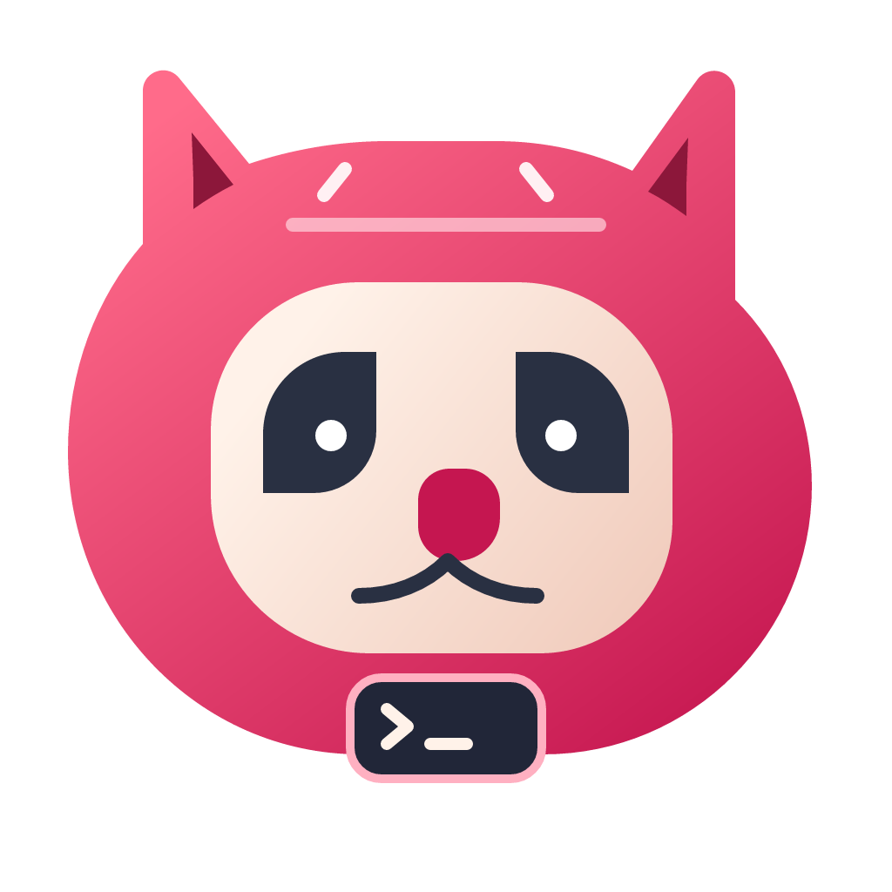

<p align="center">
  
</p>

<h1 align="center">OpsSSH</h1>

<p align="center">
  An open-source native SSH workspace for terminals, remote files, and server access.
</p>

<p align="center">
  <a href="https://github.com/priyansx01/OpsSSH/actions/workflows/ci.yml"></a>
  <a href="LICENSE-MIT"></a>
</p>

OpsSSH brings your saved servers, local and remote terminals, SFTP file manager,
and SSH key management into one desktop application. It is built in Rust with
GPUI and GPUI components, using Alacritty's terminal emulator and native
ConPTY/openpty sessions.

**Current status: 0.1.0 development preview.** Windows leads development;
Windows, macOS, and Linux are covered by build/test workflows. Broader native
compatibility, accessibility, performance, and signed distribution acceptance
remain work for the 1.0 release. There is no telemetry.

[Get started](#get-started) · [Features](#features) ·
[Contribute](#contributing) · [Roadmap](docs/ROADMAP.md) ·
[Changelog](CHANGELOG.md)

## Features

### Server workspace

- Saved connections with quick-connect SSH string parsing, display names,
  host/port fields, environment labels, tags, favorites, and search.
- Import/export of profiles and support for concrete aliases from SSH config.
- Password, private-key, SSH-agent, keyboard-interactive, and certificate
  authentication, with explicit host-key verification.
- Jump hosts, reviewed proxy commands, configurable keepalive, and optional tmux
  protection, all visible in the connection form.
- Retained tabs and a close-tab choice to stay connected in the background or
  disconnect. **Save & Connect** persists the profile before connecting.

### Native terminal

- Local shells and SSH terminals with colors, alternate-screen applications,
  selection, 100,000-line history, and multilingual text shaping.
- Terminal-first keyboard input for shells, editors, and command-line tools,
  including Claude Code and Codex. Workspace shortcuts are suspended on the
  Terminal page.
- Right-click Copy/Paste, **Ctrl+V / Ctrl+Shift+V** clipboard paste, and clipboard
  image uploads for remote terminals.
- Configurable keyboard capture on Windows for supported system shortcuts.
- Optional tmux sessions that preserve remote work across lost connections,
  automatic recovery with bounded backoff, and **Reconnect now** to retry
  immediately.

### Remote files

- SFTP browsing, uploads, downloads, cancellation, and transfer history.
- Drag files into a terminal, choose an upload destination once, and reuse it
  for later drops. Progress and retry controls stay beside the terminal.
- Successful uploads insert quoted remote paths into the original terminal
  without pressing Enter or opening the file manager.
- Explicit replacement confirmation for collisions. Downloads support
  **Replace**, **Skip**, and remaining-file choices; incomplete downloads do
  not truncate existing local files.
- File/folder copy and move, permissions presets, an advanced permissions matrix,
  octal modes, owner/group editing, and optional recursive changes.
- Open a remote directory in the current terminal or in a separate shell tab.

### SSH management

- Inspect, search, import, copy/export, edit comments, and remove public keys in
  the connected account's default `~/.ssh/authorized_keys`.
- Protect the known current key when authenticated with a key or agent, and
  check for concurrent changes before saving.
- Explicit Linux user creation with root/sudo authorization and repair of
  partially completed setup. Linux and Python 3 are required for this page.

See [SSH Management](docs/SSH_MANAGEMENT.md) for its requirements and scope.

## Get started

### Development packages

The [Build development packages workflow](https://github.com/priyansx01/OpsSSH/actions/workflows/package.yml)
produces Windows x64, macOS arm64/x64, and Linux x64/arm64 artifacts when run by
the maintainer. Open a successful run and download its platform artifact.
Windows packages include a branded MSI; archives include third-party license
notices and SHA-256 checksums. Development packages are unsigned.

Tagged packages, when published, are available on the
[GitHub Releases page](https://github.com/priyansx01/OpsSSH/releases).
You can also run directly from source.

### Build from source

Install Rust through rustup; `rust-toolchain.toml` pins **Rust 1.99.0**, rustfmt,
and Clippy. Install your platform's native dependencies:

| Platform | Prerequisites |
| --- | --- |
| Windows | Visual Studio Build Tools with **Desktop development with C++** and the Windows SDK |
| macOS | Xcode command-line tools and the Metal tooling required by GPUI |
| Linux | C/C++ linker, pkg-config, fontconfig, FreeType, xkbcommon/X11, Wayland, XCB, and OpenSSL development libraries |

For Ubuntu, the CI workflow installs:

```sh
sudo apt-get update
sudo apt-get install -y libfontconfig1-dev libfreetype6-dev libxkbcommon-dev libxkbcommon-x11-dev libwayland-dev libxcb1-dev libssl-dev
```

Clone and launch the desktop app:

```sh
git clone https://github.com/priyansx01/OpsSSH.git
cd OpsSSH
cargo run -p opsssh --locked
```

Open a local terminal directly:

```sh
cargo run -p opsssh --locked -- local
```

Build an optimized executable:

```sh
cargo build -p opsssh --release --locked
```

The executable is written to `target/release/` (`opsssh.exe` on Windows).
The desktop needs a working GPU and windowing environment. The first build
downloads dependencies; `--offline` requires a populated Cargo cache.
See [Contributing](CONTRIBUTING.md) for additional setup details.

### Connect to a server

1. Choose **New connection**. Paste an SSH command into Quick Connect or enter
   a display name, host, port, username, and authentication method.
2. Set an environment and any routing, security, or session options you need.
   Enable **Protect work with tmux** if tmux is installed on the server.
3. Choose **Save** or **Save & Connect**. Review an unknown host key before
   trusting it; changed or revoked keys stop the connection.
4. Use the connected server's navigation to switch between Terminal, Files,
   and SSH Management. Returning to Terminal keeps Files closed until you
   open it manually.

Passwords and passphrases are stored in the OS credential store only when you
opt in. OTP responses are never saved. SFTP uses the SSH login's permissions,
including when the interactive shell has entered `sudo`.

## Terminal controls

Outside the Terminal page, workspace shortcuts provide navigation:

| Action | Shortcut |
| --- | --- |
| Open local shell | Ctrl/Cmd+Enter |
| Home/search | Ctrl/Cmd+K |
| New connection | Ctrl/Cmd+N |
| Close active tab | Ctrl/Cmd+W |
| Return home, retain sessions | Ctrl/Cmd+Shift+H |
| Quit | Ctrl+Shift+Q; Cmd+Q on macOS |

Inside a terminal, input goes to the shell or terminal application. Use the
workspace buttons to navigate while an editor or harness owns the keyboard.

- Drag to select; **Alt+drag** selects a rectangle. Right-click for Copy, Paste,
  or Select all.
- **Ctrl+V / Ctrl+Shift+V** paste from the local clipboard, including while
  keyboard capture is enabled. Nonempty text takes priority over image data.
  Clipboard images follow the remote terminal's upload workflow.
- **Ctrl+C** reaches the process even when text is selected. Other terminal
  shortcuts, including Shift+Tab and Alt combinations, stay with the terminal.
- **Shift+wheel** scrolls local history instead of sending application mouse
  reports; Shift also enables local selection when mouse reporting is active.
- **Ctrl/Cmd+click** opens HTTP/HTTPS terminal hyperlinks. Multiline paste
  without bracketed-paste mode requires review.

On Windows, **Keyboard captured** forwards Alt+Tab, Alt+Shift+Tab, Alt+Escape,
Alt+F4, and Ctrl+Escape while the connected remote terminal owns focus.
**Ctrl+Alt+F12** releases capture; the toolbar enables it again. Dialogs,
menus, other pages, and inactive windows suspend capture. Windows-key
combinations and Ctrl+Alt+Delete remain local.

Disconnected terminals discard input rather than queuing it for replay.
**Reconnect now** bypasses recovery backoff; authentication and host-key
verification still apply. Tmux protects work from a network interruption,
not a server restart or terminated tmux session. File transfers have a separate
retry lifecycle. See [Session recovery](docs/SESSION_RECOVERY.md).

## Development

Run the same core checks used in CI:

```sh
cargo fmt --all -- --check
cargo test --workspace --all-features --locked
cargo clippy --workspace --all-targets --all-features --locked -- -D warnings
cargo build --workspace --release --locked
```

Backend tests can run without a desktop GPU:

```sh
cargo test --workspace --no-default-features --locked
```

Tests include local PTYs, loopback SSH, SFTP protocol fixtures, connection
persistence, and terminal input/rendering behavior. These checks do not
establish real-world GPU latency or complete TUI compatibility.

Diagnostics and parser benchmarks:

```sh
cargo run -p opsssh --locked -- diagnostics
cargo run --release -p opsssh --locked -- bench-parser 64
```

Development-only frame exports require a desktop GPU/windowing environment:

```sh
cargo run -p opsssh --features capture --locked -- snapshot home.png
cargo run -p opsssh --features capture --locked -- snapshot-local terminal.png
```

These commands export a frame after two seconds and exit. Review captures for
private paths and shell output before sharing them.

### Project layout

| Path | Responsibility |
| --- | --- |
| `crates/app` | Desktop workspace, connection forms, and file/SSH-management pages |
| `crates/term-core`, `crates/term-view` | VT parsing, input encoding, terminal rendering, and session views |
| `crates/platform` | Native application integration and local PTYs |
| `crates/ssh-core`, `crates/ssh-config` | SSH transport, authentication, recovery, and config parsing |
| `crates/sftp`, `crates/drop` | Remote filesystem operations, transfers, file drops, and clipboard images |
| `crates/ssh-management` | Authorized-key management and Linux user setup |
| `crates/store`, `crates/vault` | Saved profiles and credential storage |
| `docs`, `tests`, `fuzz` | Design notes, compatibility fixtures, and fuzzing targets |
| `scripts`, `installer`, `assets/branding` | Checks, packaging, Windows installer, and mascot assets |

## Contributing

Bug reports, documentation improvements, tests, and focused pull requests are
welcome. Read [CONTRIBUTING.md](CONTRIBUTING.md), the
[roadmap](docs/ROADMAP.md), and the [code of conduct](CODE_OF_CONDUCT.md) first.

- [Report a bug](https://github.com/priyansx01/OpsSSH/issues/new?template=bug.yml)
  with your OS, revision/version, reproduction steps, expected/actual behavior,
  and sanitized diagnostics.
- [Suggest a feature](https://github.com/priyansx01/OpsSSH/issues/new?template=feature.yml)
  describing the workflow it improves.
- For a pull request, explain the resulting behavior and validation. Discuss
  substantial product changes before implementing them.

Never include credentials, private keys, OTPs, personal server details, or
sensitive terminal output in public issues, fixtures, or screenshots.
For security concerns, follow [SECURITY.md](SECURITY.md); do not post exploits
publicly or send them to an unverified reporting address.

Contributions use the same **MIT OR Apache-2.0** license as the project, without
a CLA. Use your own valid Git identity and follow the contribution guide's
sign-off instructions.

## Road to 1.0

The application already implements SSH, terminals, SFTP, saved profiles, tmux
recovery, and SSH key management. Remaining acceptance work includes native
IME and screen-reader validation, monitor changes, full-screen terminal
applications, measured performance, and signed installers across supported
platforms. No 1.0 compatibility or performance guarantee is claimed yet.

Follow the [roadmap](docs/ROADMAP.md),
[compatibility notes](docs/COMPATIBILITY.md),
[performance methodology](docs/PERFORMANCE.md), and
[original product intent](intent.md) for scope and acceptance goals.

## License and acknowledgements

OpsSSH is available under **MIT OR Apache-2.0**, at your option.
See [LICENSE-MIT](LICENSE-MIT) and [LICENSE-APACHE](LICENSE-APACHE).

Built with GPUI, GPUI components, Alacritty's terminal emulator, portable-pty,
and the Rust SSH/SFTP ecosystem. Distributed packages include third-party
license notices; dependency review is configured in `deny.toml` and `about.toml`.
